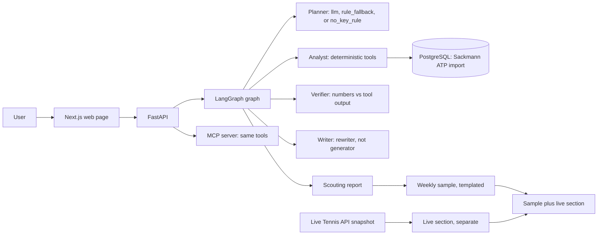

# Tennis Scout Agent (TSA)

Verifiable pre-match scouting reports for tennis. Every number in a
report comes from a database query, never from model text.

The planner parses a question. Deterministic tools compute Elo, form,
surface record, head-to-head, and match probability. A verifier checks
every number against tool output and drops or flags anything unmatched.
The writer only uses verified outputs, and it rewrites rather than
generates: it must copy numbers exactly, with no rounding, no percent
conversion, and no invented numbers.

## What it does

- Answers a matchup question with a structured scouting report:
  favorite and probability, Elo comparison, surface record, recent
  form, head-to-head, sources and tool trace, cost, latency,
  data-as-of, and a coverage note.
- Serves the same report through a FastAPI endpoint, a Next.js web
  page, and an MCP server, all from the same deterministic tools.
- Publishes a weekly sample report that is templated, with 0 LLM
  calls and 0 LLM cost, so the sample format can be checked without
  paying for a model call.
- Adds a separate live section, from a one-time Live Tennis API
  snapshot, that shows who is playing now and what the score is.
  The live section does not change the historical report, and it
  does not update the historical database.

## What it does not do

- It does not update historical Elo, form, or probability from a
  live score. A live score is an in-progress state, with no winner,
  no completed games count, and no serve statistics. Counting it
  would break the definitions of form and Elo used here.
- It does not predict a specific upcoming real match from live data.
  The historical report is anchored at its data-as-of date, and the
  live section is a snapshot with its own fetched_at timestamp.
- It does not include odds. Odds are parked, not v1, and are
  post-ship research only.
- It does not cover WTA in v1. The import and the model are ATP
  first. WTA is deferred, not guessed.
- It does not add weather, tournament level, or court speed
  corrections. Those are parked, and adding one requires lowering
  both log loss and Brier score on 2018-2025 and on 2024-2025,
  not just changing a template.

## Demo in 2 minutes, local

Prerequisites, in order: Python 3.12, a local PostgreSQL database
with the Sackmann ATP import already loaded (see Data, below),
and a `.env` file with `DATABASE_URL`. An LLM key is optional:
without it, the planner falls back to the rule planner, and the
label for that fallback is shown in the report. A Live Tennis API
key is optional, and it is only needed for a fresh live snapshot.

1. Start the API, then open the web page. The web page shows the
   report text verbatim, plus planner source, plan, model, whether
   LangGraph was used, and verification. On failure it shows an
   error only, never an unverified report. The frontend computes
   no numbers.
2. Ask for Jannik Sinner vs Carlos Alcaraz, Hard. The expected
   historical result, from the data as of 2026-05-25, is:
   favorite Jannik Sinner, final calibrated probability 0.6378
   vs 0.3622, blended probability before calibration 0.6698
   vs 0.3302.
3. Open `samples/weekly_sample.md` for the same matchup in sample
   form, then open `samples/weekly_sample_with_live.md` for the
   same historical sample plus a separate live section. Check
   that the historical numbers did not change when the live
   section was added.

## Architecture



Nodes, in plain terms:

- Planner: parses the question into player names, surface, and
  question type. Sources are exactly `llm`, `rule_fallback`, and
  `no_key_rule`. The fallback is labelled, and it is allowed for
  the planner only. The writer has no fallback to a template on
  LLM call failure or verification failure.
- Analyst tools, deterministic, SQL and Elo only:
  `get_player_elo`, `get_player_form`, `get_head_to_head`,
  `get_player_surface_record`, `get_match_probability`,
  plus `generate_scouting_report` on the MCP server.
- Verifier: checks every number against tool output. For the LLM
  writer version, it requires the calibrated and blended
  probabilities, both players' overall and blended Elo, and the
  head-to-head total and wins. It does not require every
  templated value to appear.
- Writer: LLM rewriter. It must copy numbers exactly, use the
  correction tags actually applied, and add no section numbers,
  no rounding, and no invented numbers. Default model for the
  writer and planner in the current graph files is
  `gemini-3.5-flash-lite`.
- MCP server: exposes the same six tools over stdio. Tool errors
  return JSON, never crash the server, and tool code never prints
  to stdout. The server was verified with a venv MCP client test,
  not with the Inspector uv route, which is a separate Inspector
  configuration issue, not a server issue.
- Eval: a deterministic harness, rule planner plus templated
  report, no LLM, with a failure log that is overwritten on each
  run and an exit code of 1 on failure.
- Weekly sample: templated, no LLM, with metadata, sources table,
  tool trace, cost and latency, coverage note, and a verification
  gate that writes no file on verification failure.
- Live snapshot: a one-time fetch, FREE tier only, live and
  upcoming only, no retry on 429 or 403, no auto pagination.
  Completed and cancelled are refused before any HTTP call,
  because on a FREE key they belong to the paid History product.

## Locked model

Overall Elo starts at 1500, K is 32, ordered by tourney_date,
tourney_id, and match_num. Surface Elo is per surface, also
1500 and K 32. The blend is:

```
blended = w * surface_elo + (1 - w) * overall_elo
w = n_surface / (n_surface + 100)
```

The prior is 100. A missing surface uses overall Elo only.
Calibration is:

```
p_final = sigmoid(0.8 * logit(p_blended))
```

with b equal to 0.0. The full pipeline is overall Elo, then
surface blend, then calibration.

Backtest, 2024-2025, for this locked model: log loss 0.6268,
Brier score 0.2193. Descriptors only, not probability inputs:
win form, games percentage, reliability label, head-to-head,
and retirement as an observable mid-match retirement, never
as an injury diagnosis.

Example, verified in Weeks 2 to 4:

- Sinner vs Alcaraz, Hard: blended 0.6698 vs 0.3302, calibrated
  0.6378 vs 0.3622.
- Sinner vs Alcaraz, Clay: blended 0.5613, calibrated 0.5492
  for Sinner.
- Head-to-head, raw only: 17 meetings, Sinner 7 wins, Alcaraz
  10 wins; Hard 10 meetings, Sinner 3 wins, Alcaraz 7 wins.
- Sinner overall Elo 2283.1 over 457 matches, Hard Elo 2236.0
  over 308 matches, Hard blended 2247.6, Hard record 251 wins
  and 57 losses, win rate 0.8149.
- Alcaraz overall Elo 2176.7 over 371 matches, Hard record
  159 wins and 44 losses, win rate 0.7833.

The final probability line must carry the correction tags
actually applied, for example
`[Surface blend: Hard, prior=100] [Calibration: a=0.8]`.
The calibration tag is always present. The surface tag is
present only when a surface is specified and at least one
player has matches on it. Surface correction applies to all
surfaces, including Hard.

Language: the answer language follows the question language.
If the question contains a Chinese character, the answer is
Chinese, otherwise it is English, with English as the default.
This applies to answers and to errors.

## Data and coverage

Source: Jeff Sackmann ATP data, imported main tour only, from
a mirror, because the original repositories are no longer public
(see Hard ceiling, below). The import in this project is:

- Players: 66,912. Matches: 199,389, in 59 files.
- Match date range: 1967-12-28 to 2026-05-25.
- Surfaces: Hard 80,877, Clay 70,920, Grass 23,702, Carpet
  20,900, NULL 2,990.
- Rankings: 3,419,815 rows, 1973-08-27 to 2026-06-08.
- Data-as-of per table: matches to 2026-05-25, rankings to
  2026-06-08. The report data-as-of is 2026-05-25, the maximum
  match date, and that is the date that governs the report.

Coverage audit, for context on what the tools can and cannot
use: serve statistics coverage is 79.8 percent in the 1990s,
88.3 percent in the 2000s, 92.5 percent in the 2010s, and
93.9 percent in the 2020s. Rank coverage is 44.7 percent in
the 1970s, 98.1 percent in the 1990s, and 99.5 percent in the
2020s. Elo, head-to-head, and surface record use full history.
Serve statistics use 1991 and later, ideally 2000 and later.
Tourney_date in the source is tournament start, not exact
match day, so a 52-week form window is accurate to within a
tournament length.

Hard ceiling, read this before expecting newer data:

- The original `JeffSackmann/tennis_atp` and `tennis_wta`
  repositories returned 404 from 2026-06-29, re-confirmed
  2026-07-02, with the account down to 1 public repository.
  The blog is dormant since 2026-04-16. This matches a prior
  pattern of taking the repositories private over data
  licensing disputes, and they have been restored before,
  so the timing of any return is unknown.
- The mirror used for the import in this project last
  committed on 2026-06-08, after 2026-05-25 and 2026-05-06,
  and before that on 2024-12-30. There is no fixed schedule.
- The archival mirror `Aneeshers/tennis-sackmann-archive`
  is a June 2026 snapshot, with the same ceiling: rankings
  to 2026-06-08, matches to 2026-05-25. Re-running a download
  from that mirror will not surface anything newer until the
  mirror is updated or the original repositories return.
- Tennis Abstract Elo pages are updated weekly, last noted
  2026-11-02, with Sinner Elo 2296.9 on that date, but Tennis
  Abstract provides HTML leaderboards, not CSV match history,
  and its Elo model differs from the K 32 model here. It can
  be a reference, it cannot directly replace the Elo here or
  update the Sackmann database in the same format.

This repository contains code, eval cases, and sample reports.
It does not contain a PostgreSQL dump. A fresh clone does not
automatically give you the full database. To reproduce the full
database, run the import from Sackmann CSVs if a current copy
is available, otherwise run the pure tests and use the cached
sample reports, which are checked in as dated examples.

Attribution and license for the Sackmann data: Jeff Sackmann,
Creative Commons Attribution-NonCommercial-ShareAlike 4.0
International (CC BY-NC-SA 4.0). Use is non-commercial, and
redistribution must carry the same license.

## Verified metrics

All numbers below are from runs on the developer Mac, not from
GitHub Actions, because the workflow does not actually run
until the repository is pushed to GitHub in Week 8. Dates are
given so a reader can tell a measured result from a target.

| Metric | Result | When and how |
| --- | --- | --- |
| Eval set | 100 cases, 100 passed, pass rate 1.0000 | 2026-11-02, deterministic harness, rule planner plus templated report, no LLM |
| Eval cases, first 30 | Preserved verbatim in the 100 case set | Validator check, see CI gate below |
| Full test suite | 150 collected, 149 passed, 1 skipped, 21.12 seconds | 2026-11-02, Mac pytest. The 1 skipped test is the scout graph fallback test, skipped because LangGraph is installed, which is expected |
| API tests | 8 passed, included in the full suite above | Week 5 Step 1, established in the Week 6 Step 4 full run |
| Weekly sample, Sinner vs Alcaraz Hard | Favorite Sinner, calibrated 0.6378, blended 0.6698, verification ok, latency 426.8 ms, tool calls 8, LLM calls 0, LLM cost 0.00 dollars | 2026-11-02, Mac sample run, file `samples/weekly_sample.md` |
| Weekly sample tests | 4 passed, 0.59 seconds, including a real database sample test | 2026-11-02, Mac pytest |
| MCP client test | Tools list 6, Elo Sinner 2283.1 over 457 matches, probability Hard calibrated 0.6378 blended 0.6698, report planner source llm, verification ok | 2026-11-02, venv MCP client test, bypassing Inspector |
| Live snapshot, example | 15 live matches, total 15, has_more false, rate limit per minute 30, remaining 29 after 1 call | 2026-11-02 21:28 EST, FREE key, 1 call, file `live/fixtures.json`. This is a dated example, not a live feed |
| Live section tests | 11 passed, 0.02 seconds, after a test assertion fix for Sets 0-0 vs Games withheld | 2026-11-02, Mac pytest, file `samples/weekly_sample_with_live.md` |
| Cost targets | Median under 0.05 dollars per report, p95 under 0.15 dollars per report | Targets, not measured medians. The templated sample measures 0.00 dollars because it uses no LLM. LLM writer cost medians have not been measured as a distribution yet, and must not be quoted as measured |

## Project structure

```
backend/                  FastAPI app entry, backend/app/main.py
scripts/                  Deterministic tools, Elo, form, surface,
                          probability, templated report, LangGraph
                          graph, LLM writer and planner, MCP server,
                          eval harness, eval case generator, weekly
                          sample, live fixtures, live section, eval
                          case validator
tests/                    Pytest suites for tools, report, graph,
                          API, MCP, eval, weekly sample, live
                          fixtures, live section, validator
web/                      Next.js web page, Next 14.2.35, React 18.3.1
samples/                  Weekly sample, and sample plus live section
live/                     Live snapshot JSON, from a one-time fetch
eval/                     Eval cases, and failure log overwritten
                          on each eval run
data/                     Raw import files only, data/raw/, ignored
                          by .gitignore, not committed
docker-compose.yml        Local PostgreSQL service
Makefile                  Local convenience commands
.env.example              Template env file, no secret keys, safe to
                          commit. Real values live only in .env,
                          which is ignored
.python-version           Python version for the project
.github/workflows/        CI workflow, see CI gate below
requirements.txt          fastapi, langgraph, psycopg, mcp, uvicorn,
                          pytest, versions not pinned in the Week 6
                          version
```

## Run locally

These are the commands already used in Weeks 1 to 7, in
execution order. A prerequisite goes before the run command,
never after it.

Prerequisite: activate the venv, and load `.env` so
`DATABASE_URL` and any optional keys are available. Keys are
typed by the developer into `.env`, never pasted into chat,
code, or GitHub.

```
cd ~/TSA
source .venv/bin/activate
set -a; source .env; set +a
python -m pytest tests/ -v
python scripts/weekly_sample.py
python scripts/live_fixtures.py --status live
python scripts/live_section.py
```

Notes on each command:

- Full pytest runs DB tests only when `DATABASE_URL` is set.
  Without it, DB tests skip, and the validator plus pure tests
  still run. That is intentional, see CI gate below.
- `weekly_sample.py` needs a database connection. It writes
  `samples/weekly_sample.md` and prints the full sample.
- `live_fixtures.py` needs `LIVE_TENNIS_API_KEY` in `.env`.
  It costs 1 call for a listing, plus 1 call per match if
  `--score-for-first N` is used, which defaults to 0. It
  writes `live/fixtures.json`. If the key is missing, it
  stops before any HTTP call and spends no quota.
- `live_section.py` needs no key and makes no API call. It
  reads `samples/weekly_sample.md` and `live/fixtures.json`
  and writes `samples/weekly_sample_with_live.md`. It never
  overwrites the original sample.
- API and web startup follow the Week 5 steps: FastAPI on
  localhost, Next.js in `web/` with CORS allowing only
  127.0.0.1:3000 and localhost:3000. Frontend code computes
  no numbers.

## CI gate

Workflow file: `.github/workflows/test.yml`, on push and pull
request, Python 3.12, install from `requirements.txt`, run the
eval case validator, then run pytest.

- Validator: `scripts/validate_eval_cases.py`, no database, no
  LLM. It checks JSON validity, unique ids, first 30 cases
  preserved, and total at least 100, and exits 1 on failure.
  On the Mac run it reported Total 100, Unique ids 100,
  First 30 preserved True, Validation OK, with 6 validator
  tests passed.
- `DATABASE_URL` is not set in CI, so DB tests skip in CI.
  The full 100 case database eval is not run in CI. It remains
  a local pre-merge gate on the developer machine.
- The workflow alone does not block a merge. Branch protection
  must be enabled in the GitHub repository settings after the
  Week 8 push, to make the workflow a real gate. The workflow
  will not actually run until the repository is pushed in
  Week 8.

## Weekly sample and live snapshot, how to read them

Historical sample: data as of 2026-05-25, templated, no LLM,
with a sources table and a tool trace. Read its probabilities
as historical probabilities, not as current probabilities.

Live section: fetched_at in UTC, source Live Tennis API, tier
FREE, status requested, count in snapshot, and first 5 fixtures
in snapshot order, or all fixtures if fewer than 5. Each fixture
shows player names, tournament, tour, status, surface if known,
scheduled time if known, and score. Score rendering follows the
provider definition: sets is per player, games is player-major
(for example, games `[[6, 3], [4, 4]]` means 6-4 in the first
set and 3-4 in the second), points is per player in the current
game, server is 1 for p1 and 2 for p2. A missing score reads as
No score yet, never as 0-0. Games null reads as Games withheld,
never as 0-0. A missing name reads as Unknown, never as an
invented name.

Live Tennis API, FREE tier, verified 2026-11-02 from official
docs: 0 dollars, no card, never expires, 100 requests per day,
30 per minute, live and upcoming matches, current scores,
players, fixtures, tournaments, base URL
`https://api.livetennisapi.com/api/public/v1`, key in the
`X-API-Key` header, endpoints `GET /matches?status=live`,
`GET /matches/{id}/score`, `GET /players/{id}`, and
`GET /tournaments`. Completed match history is Basic, 9.99
dollars per month. Market prices are Pro, 29.99 dollars per
month. Model fields, WebSocket, and rankings are Ultra, 99.99
dollars per month. A FREE key may spend 20 calls per calendar
month on history endpoints as a taste, then a 403
`upgrade_required` is returned. A call above plan returns 403
`upgrade_required`, never a silent empty result. An empty data
array can mean no matches are live at fetch time, and it must
be reported as such, not as a failure or a stale score.
Polling every 30 seconds lasts 50 minutes on FREE, and 8 hours
costs 960 calls, so a continuous dashboard is not feasible on
FREE. A weekly sample at well under 10 calls per sample,
generated once, not polled continuously, is feasible.

Provider match and player ids do not match Sackmann ids. Any
join must be by player name, with ambiguity handling, never by
id. An unmatched name must be reported as unmatched, not forced
to a nearest player.

## Limitations and parked scope

- Data cutoff is 2026-05-25 for matches, and it will get staler
  until a new Sackmann snapshot or a validated replacement
  source is available. The README states the cutoff on every
  report, rather than hiding it.
- ATP only in v1, main tour only in the import. Challenger and
  qualifying files exist in the source data, but they are not
  part of the v1 import used for the locked model.
- No odds, no in-play model, no serve based probability input.
  Serve statistics are descriptors and coverage context only.
- Persistent LangGraph checkpointing beyond MemorySaver is
  deferred. LLM planner injection cleanup and 503 retry and
  backoff are deferred, not started.
- Deployment is planned, not done, in this README version:
  Vercel free tier frontend, API and Postgres free tier hosts,
  with a public demo that degrades to cached sample reports.
  Until deployment is done, the demo runs locally, as described
  above.
- Travel pause: 2027-01-28 to 2027-02-17, Oman and Sri Lanka.
  The goal is a demoable version before departure, with polish
  after return. Weeks 9 to 10 are buffer and interview prep.

## Attribution

Tennis data: Jeff Sackmann, CC BY-NC-SA 4.0, non-commercial.
Live scores in the live section only: Live Tennis API, FREE
tier, with fetched_at and source stated in the section itself.
All other numbers in a report are from the local Sackmann ATP
import, through deterministic tools, as listed in the tool trace.
